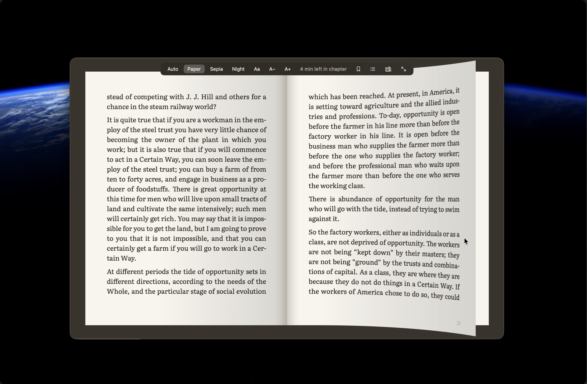
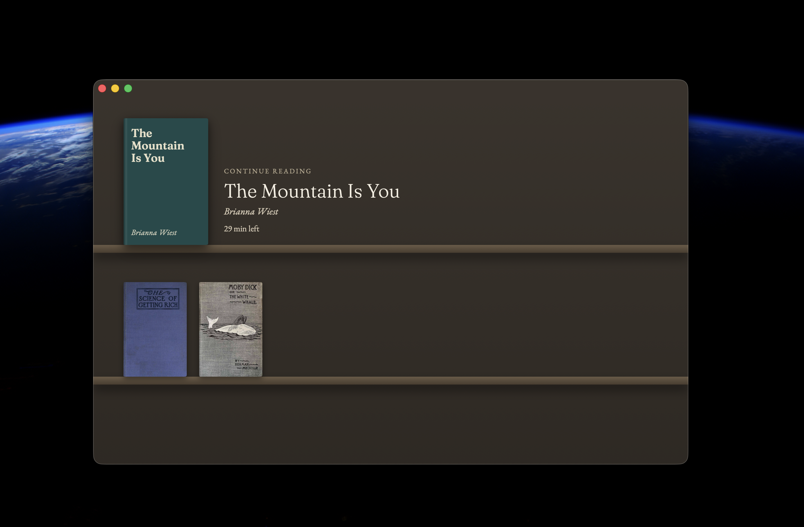
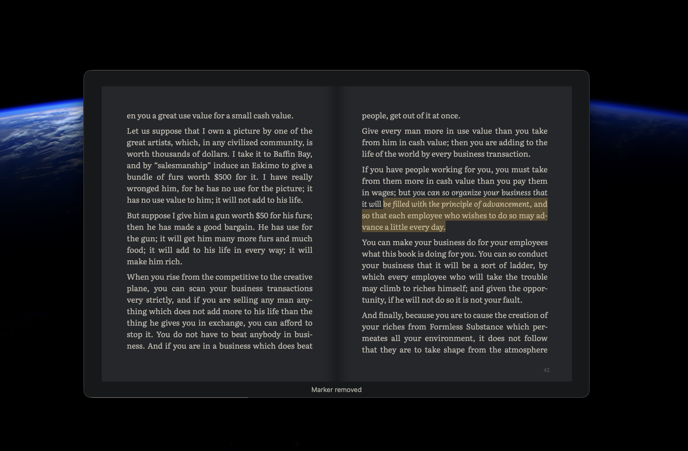

# Readme

A quiet EPUB reader for the Mac, and now for Windows. Books open as a two-page spread that turns
with a page curl, set in a proper book typeface, with highlights, a page marker and search.



| Library shelf | Night theme |
|:---:|:---:|
|  |  |

## Features

- **Library shelf.** Drag EPUB files onto the shelf, or onto Readme's icon in the Dock. Books
  without a cover get one drawn for them. Readme keeps its own copy of each book.
  Search the shelf by title or author from the magnifier in its corner, or with ⌘F.
- **Book-like pages.** Two pages side by side, turned with a page curl from the keyboard or a
  trackpad swipe, with a page number in the corner of each spread.
- **Your choice of type.** EB Garamond, Literata or New York, with adjustable text size and
  line width.
- **Themes.** Paper, Sepia and Night, or Auto to follow the Mac's light or dark appearance.
- **Highlights.** Select text to highlight it, and see them all in the Highlights sidebar.
- **Page marker.** Mark a page with a ribbon and jump back to it later.
- **Search.** Find any word or phrase in the book, and go straight to a result.
- **Contents and Go to Page.** Jump to a chapter or a page number.
- **Picks up where you left off.** Your place in every book is remembered.
- **Export and import.** Take your books, with their highlights, page marker and place, to another
  Mac in one `.readmelibrary` file. Importing never replaces a book you already have.
- **Updates itself.** **Readme > Check for Updates…** finds a new version, and **Update and
  Restart** installs it and opens Readme again. If you agree when asked, it checks once a day on
  its own, and always asks before installing.
- **Private.** No accounts and no tracking. The app is sandboxed, and books, highlights and
  settings stay on your Mac. The update check only asks GitHub for the latest release. Installing
  is done by a small helper inside the app, Readme Updater, which runs outside the sandbox only
  while it updates: it upgrades with Homebrew if that's how you installed Readme, and otherwise
  downloads the release from GitHub and checks its SHA-256 before replacing the app.

Books with copy protection (DRM) can't be opened.

## Requirements

- A Mac with Apple silicon (M1 or later)
- macOS 14 Sonoma or later

## Install

### Homebrew (recommended)

```bash
brew install --cask rajanchavda/tap/readme
```

Update:

```bash
brew upgrade --cask readme
```

Remove:

```bash
brew uninstall --cask readme
```

To remove your library, highlights and settings as well:

```bash
brew uninstall --zap --cask readme
```

The cask clears macOS's download flag after installing, so there's no "can't verify" message to
click through.

### Download

1. Download `Readme-<version>.dmg` from the
   [latest release](https://github.com/rajanchavda/readme/releases/latest).
2. Open it and drag **Readme** onto **Applications**.
3. The first time you open it, macOS says it can't verify the app, because Readme isn't signed
   with an Apple developer account yet. Allow it once in **System Settings > Privacy & Security >
   Open Anyway**. The full steps are in [docs/install.md](docs/install.md).

To check the download, put the `.sha256` file from the release next to the DMG and run
`shasum -a 256 -c Readme-<version>.dmg.sha256`.

## Windows

Readme for Windows needs Windows 11 (Intel, AMD or ARM). It does everything the Mac app does, with
Ctrl in place of ⌘, and its library moves between a PC and a Mac in one `.readmelibrary` file.

It's on its way to the Microsoft Store, which will install and update it. Until it's listed there,
build it from source as `windows/README.md` describes. Installing, first steps and uninstalling are
in [docs/install-windows.md](docs/install-windows.md).

**Private on Windows too.** No accounts and no tracking. Readme opens only the books you give it,
keeps its library in `Documents\Readme`, and doesn't go online itself: a book can't load anything
from the web. The Store app runs as a desktop app with full trust rather than in a sandbox, and
uninstalling it keeps your library.

## Keyboard shortcuts

Press **?** (or **⌘/**) while reading to see these in the app.

| Keys | Action |
|---|---|
| → or Space | Next page |
| ← | Previous page |
| ⌘+ / ⌘− | Bigger / smaller text |
| ⌘↑ or Home | Go to the start |
| ⌘↓ or End | Go to the end |
| ⌘G | Go to a page number |
| ⌘F | Find in the book |
| ⌘D | Mark or unmark this page |
| ⇧⌘D | Go to the marked page |
| ⌘T | Show or hide the contents |
| ⇧⌘H | Show or hide your highlights |
| ⌘L | Show the library |
| ⌘O | Open a book |
| ⌃⌘F or F | Full screen |
| Esc | Close a panel or leave full screen |

## Build from source

Needs Xcode and [XcodeGen](https://github.com/yonaskolb/XcodeGen) (`brew install xcodegen`).

```bash
git clone https://github.com/rajanchavda/readme.git
cd readme
scripts/build_app.sh        # builds build/Readme.app
open build/Readme.app
```

`xcodegen generate` creates `Readme.xcodeproj` if you'd rather work in Xcode.
Run the tests with `scripts/test.sh`.

## Docs

- [Installing, step by step](docs/install.md)
- [Homebrew and the release workflow](docs/homebrew.md)
- [Releasing an update](docs/releasing.md), on Mac and Windows
- [Installing on Windows](docs/install-windows.md)
- [Building the Windows app](windows/README.md)
- [The `.readmelibrary` format](docs/readmelibrary-format.md)

## Credits

Readme is built on [foliate-js](https://github.com/johnfactotum/foliate-js) and
[zip.js](https://github.com/gildas-lormeau/zip.js), and bundles the EB Garamond, Literata and
Fraunces fonts. Their licences are in [THIRD_PARTY_NOTICES.md](THIRD_PARTY_NOTICES.md).
